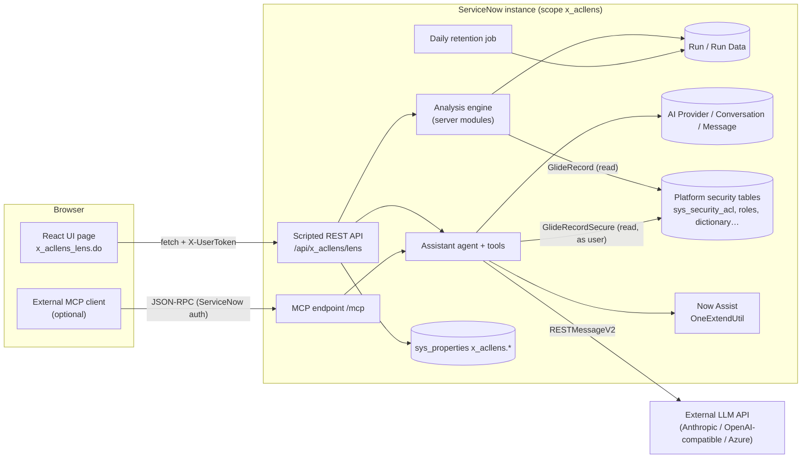

# 02 — System Architecture

## 1. Components



| Component | Fluent definition | Implementation |
|---|---|---|
| UI page (React 19, plain components on Horizon tokens) | `src/fluent/ui-pages/acl-lens.now.ts` | `src/client/**` |
| Scripted REST API (`serviceId: lens`) | `src/fluent/rest/lens-api.now.ts` | `src/server/rest/handlers.ts`, `ai-handlers.ts` |
| Analysis engine | — (server modules) | `src/server/engine/*` |
| AI assistant, tools, providers, MCP | — | `src/server/ai/*` |
| Settings, clearing, retention | `src/fluent/settings.now.ts` (properties, job, UI policy, UI action) | `src/server/admin/settings.ts` |
| Tables | `src/fluent/tables/*.now.ts` | — |
| Roles, ACLs, cross-scope privileges | `src/fluent/security/*.now.ts` | — |
| Navigator | `src/fluent/navigation/menu.now.ts` | — |

## 2. Request flow — analysis / comparison

1. The UI calls `POST /runs` with subjects, filter and `run_type`.
2. `executeRun` creates a run record with `status=running`. If history is off, nothing is stored ([ADR-0005](../adr/ADR-0005-history-governance.md)).
3. `analyze` resolves the subjects' effective roles, loads the table hierarchy (`sys_db_object`), and loads the ACLs and ACL roles. The ACL load is targeted to the candidate tables when there are ≤150 of them. It then evaluates every table and field rule for every subject ([03](03-access-evaluation-engine.md)).
4. For `compare`, it also runs the comparison script and attaches a CSV to the run. For a rerun, it computes drift against the original.
5. Results are stored as chunked JSON ([ADR-0002](../adr/ADR-0002-run-history-storage.md)), and the run record gets summary counts and the duration.
6. The full payload is returned. The UI caches it so opening the run doesn't refetch.

## 3. Request flow — assistant

`POST /ai/chat` → pick provider (Now Assist if available → *Default* → lowest *Order*) → loop: the model replies with a JSON action → a read-only tool runs as the user → the result is fed back. The loop stops after at most 6 tool calls, or earlier when the model answers. The answer and the list of tools used are stored in the user's conversation ([05](05-ai-assistant-and-mcp.md)).

## 4. Project layout

```
now.config.json            scope, scopeId, name
now.prebuild.mjs           client build (rollup) + embeds app.css into styles.generated.ts
src/fluent/                Fluent metadata (.now.ts) - tables, security, REST, UI page, menu, settings
src/fluent/generated/      keys.ts (record identities - commit, do not hand edit)
src/server/engine/         analysis engine, storage, runs
src/server/ai/             assistant: providers, agent loop, tools, MCP, guidance, provider test
src/server/admin/          settings, history clearing, retention
src/server/rest/           REST route handlers
src/client/                React UI (components/, assistant/, services/, utils/)
tests/offline/             offline tests (engine + assistant loop)
docs/                      this documentation
```

## 5. Build pipeline

`npm run build` (now-sdk build):
1. Type-checks Fluent and server modules.
2. Runs `now.prebuild.mjs`: copies `src/client/app.css` into `styles.generated.ts` ([ADR-0004](../adr/ADR-0004-styles-in-js-bundle.md)), then bundles the client with rollup into `dist/static`.
3. Compiles Fluent into XML in `dist/app`. Every file in `src/server` becomes a `sys_module` record.

`npm run deploy` installs `dist/app` on the authenticated instance and prints a rollback link.

## 6. Performance

| Measurement (PDI, 2026-10-08) | Result |
|---|---|
| 6 tables, 1 user + 1 role, with field rules | ~4.5 s (schema 2.1 s, ACLs 0.7 s, evaluate 0.3 s) |
| `itil` vs `admin`, "secured by roles", capped at 1,500 of 2,571 tables | ~108 s, 15,547 differences; UI renders fine |

- Each run records per-phase timings in `results.timings`.
- The default cap is 1,500 tables (`maxTables`, hard limit 5,000). Broad roles such as `admin` should use a table list or prefix.
- Analyses run synchronously in the REST transaction. Very large scopes may approach the platform's REST transaction quota; narrow the filter if that happens.
